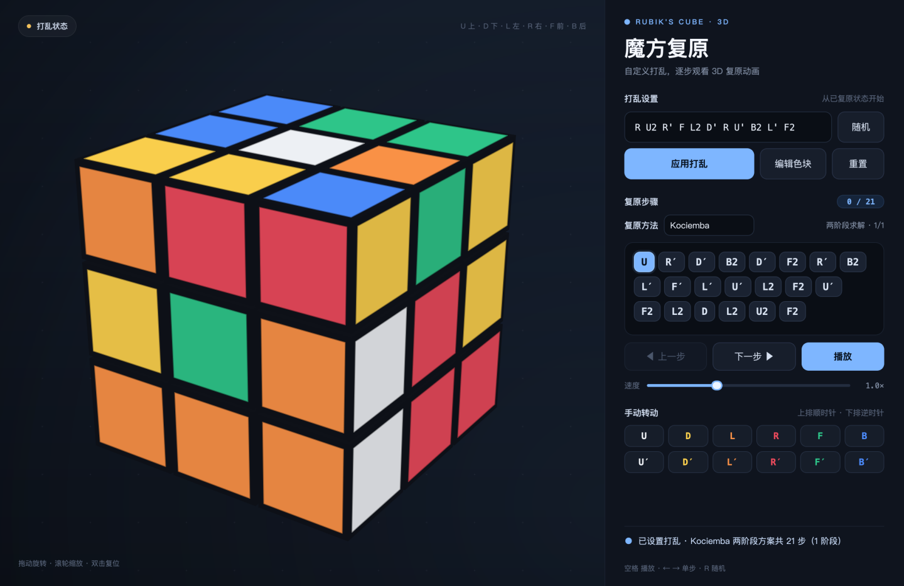
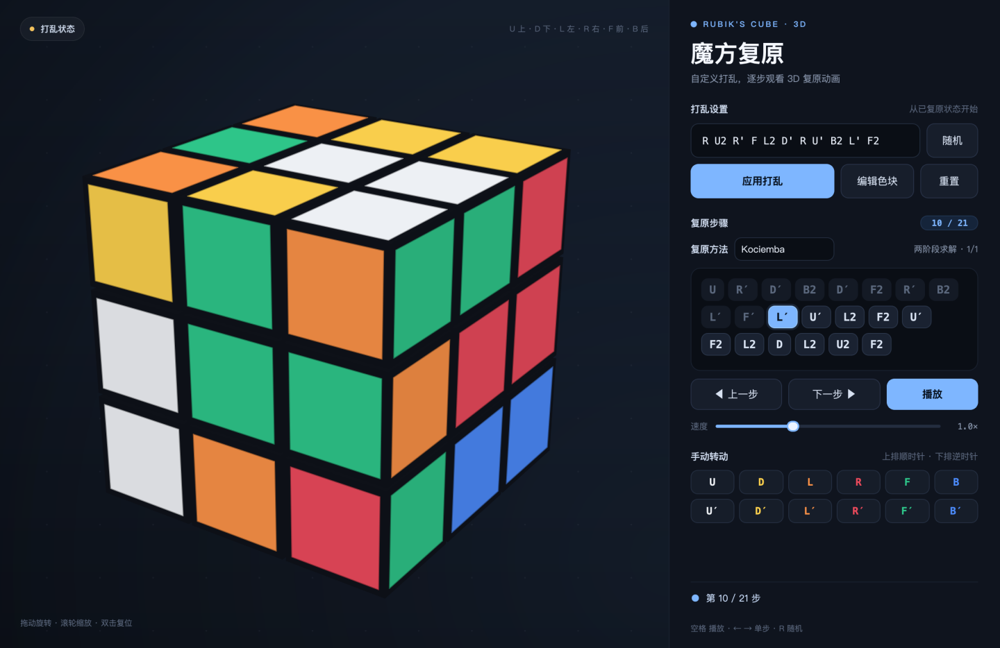
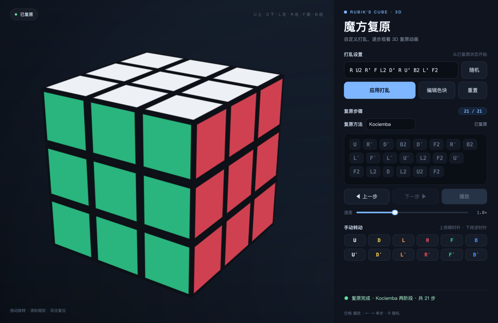
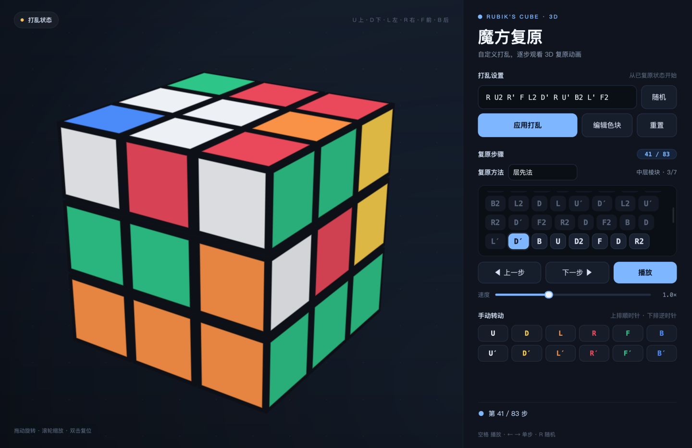
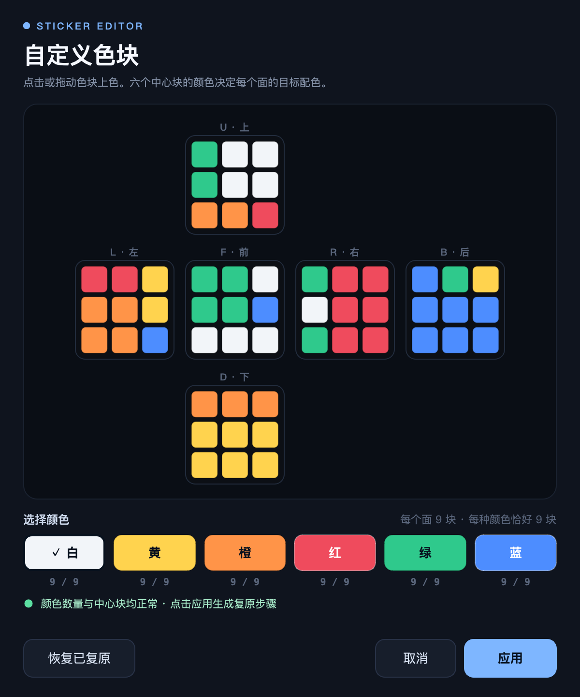

# 魔方复原 · Rubik's Cube 3D

一个用 Python + PySide6 编写的 3D 魔方复原动画。输入自己的打乱公式，逐帧、单步或自动播放复原过程；也可以打开色块编辑器，直接绘制任意贴纸状态，或随时手动转动任意一面。内置 Kociemba 两阶段求解，并提供层先法、CFOP、Roux、ZZ 四种按人类方法分阶段展示的复原方案。



## 功能

- **自定义打乱**：从已复原状态开始应用任意 Singmaster 记法公式，例如 `R U2 R' F L2 D' R U' B2`。支持省略空格、小写字母和排版撇号 `′`。
- **五种复原方法**：Kociemba 两阶段、层先法（LBL）、CFOP、Roux、ZZ。由「复原方法」下拉框随时切换，切换后从当前状态重新生成方案；人类方法会在步骤区显示当前阶段与阶段进度。
- **随机打乱**：一键生成并应用 20 步随机打乱。
- **单步控制**：「下一步」「上一步」按钮逐转执行/回退，步骤条实时高亮当前步骤。
- **自动播放**：播放、暂停，速度在 0.5×–2.0× 之间连续可调。
- **色块编辑器**：弹窗中显示 54 个色块的展开图，选颜色后点击或拖动即可逐个上色；实时检查每种颜色是否恰好 9 块、中心块是否互不相同。任意合法状态都会用当前选择的复原方法生成步骤。
- **手动转动**：右侧 12 个按钮可直接转动六个面（上排顺时针、下排逆时针）；每次手动转动后自动用当前方法重新计算复原方案。
- **3D 交互**：拖动旋转视角，滚轮缩放，双击恢复默认视角。
- **状态反馈**：未复原/打乱中/已复原徽章，步骤进度，当前转动提示；复原完成时有一圈庆祝旋转。

快捷键：`空格` 播放/暂停 · `←` / `→` 上一步/下一步 · `R` 随机打乱。

| 打乱                                   | 单步进行中                            | 复原完成                            |
|----------------------------------------|---------------------------------------|-------------------------------------|
|  |  |  |

## 五种复原方法

侧栏「复原方法」下拉框可以在 Kociemba 与四种人类方法之间切换。切换时会从当前魔方状态重新求解，并重置步骤进度；步骤区右侧显示当前阶段与阶段编号。



| 方法            | 阶段                                                                         |
|:---------------:|------------------------------------------------------------------------------|
| Kociemba 两阶段 | 一次求出完整复原步骤（在界面中显示为一个阶段）                               |
| 层先法 LBL      | 底面十字 → 第一层角块 → 中层棱块 → 顶面十字 → 顶面颜色 → 顶角归位 → 顶棱归位 |
| CFOP            | 底面十字 → F2L 第 1–4 组 → OLL → PLL                                         |
| Roux            | 左侧块 → 右侧块 → CMLL → LSE                                                 |
| ZZ              | EOLine → F2L 第 1–4 组 → OLL → PLL                                           |

四种人类方法不是把固定公式硬编码，而是把方法拆成真实的阶段目标，再用 Kociemba 的 pattern 模式逐阶段求解：

1. **构造阶段目标**：该阶段应完成的角块/棱块归位，需要定向的块朝向正确；其余块尽量保留当前的位置和朝向。
2. **阶段求解**：调用 `kociemba.solve(当前状态, 阶段目标)`，得到从当前状态到阶段目标的转动。
3. **阶段校验**：用项目自己的魔方模型回放这些转动，确认该阶段的目标确实达成，再进入下一阶段。

因此阶段顺序、每阶段完成的块和朝向都是方法定义的；阶段内部的单步转动由两阶段求解器生成，不会逐字复刻人类公式。Roux 的 LSE 与 ZZ 的 F2L 也没有强制只使用 `M/U` 或 `R/L/U/D`（本项目的转动记号只包含六个面），但每个阶段结束时方法要求的块与朝向都确实完成。所有阶段结束后还会再回放一遍完整方案，确认魔方复原。

### 色块编辑器

点击「编辑色块」打开弹窗。它从当前状态读取 54 个色块，以标准十字展开图显示：



- 先在下方选颜色，再点击或拖动色块上色；中心色块也可以修改，六个中心块决定每个面的目标配色。
- 每种颜色必须恰好 9 块且中心块颜色互不相同；不满足时「应用」不可用，并会指出需要调整的颜色。
- 颜色数量正确但组合在真实魔方上不可达时，求解会失败并在弹窗内提示，可以继续修改后重试。
- 「恢复已复原」把所有色块恢复为标准配色；「应用」成功后会替换当前状态，并按主窗口当前选择的复原方法生成新的逐步方案。

## 快速开始

```bash
cd MagicCube
./run.sh
```

`run.sh` 会使用项目内的 `.venv`；如果它还不存在，会自动创建并安装依赖。

手动运行：

```bash
python3 -m venv .venv
source .venv/bin/activate
pip install -r requirements.txt
python main.py
```

依赖 PySide6 和 Kociemba 求解器（需要 Python 3.10+）。项目在 macOS、Python 3.14.10、PySide6 6.12.0、kociemba 1.2.1 上开发和测试，不依赖系统 Tk。

## 使用说明

1. 在「复原方法」下拉框选择 Kociemba、层先法、CFOP、Roux 或 ZZ。
2. 在「打乱设置」输入公式，或点击「随机」生成一个 20 步打乱。
3. 点击「应用打乱」。24 步以内的打乱会先播放打乱动画，更长则立即应用；随后用当前方法生成复原步骤。
4. 用「下一步」单步执行，用「上一步」回退；点击「播放」自动连续复原。拖动速度滑块调整动画快慢。
5. 点击「编辑色块」打开色块编辑器，可直接设置任意贴纸布局；应用后会按当前方法生成复原方案。
6. 也可以在「手动转动」区直接拧动某个面。方案会根据当前状态和当前方法重新生成，从当前状态继续复原。
7. 拖动左侧空白区域旋转视角，滚轮缩放，双击复位视角。

### 记号

| 记号                    | 含义                         |
|-------------------------|------------------------------|
| `U` `D` `L` `R` `F` `B` | 上、下、左、右、前、后六个面 |
| `'` 或 `′`              | 逆时针 90°                   |
| `2`                     | 180°                         |

示例：`R U2 R' F L2 D' R U' B2 L' F2`。

## 复原方案是怎么来的

打乱公式、随机打乱、手动转动和色块编辑器中的任意贴纸状态都不会保存或反演打乱历史，而是从当前 54 个色块重新求解。[Kociemba 两阶段算法](https://github.com/hkociemba/RubiksCube-TwophaseSolver) 是统一的求解引擎：

1. **读取色块**：当前 54 个色块会转换成 Kociemba 需要的 U/R/F/D/L/B 字符串。每个面的目标颜色由该面中心块决定，因此交换中心色块后也能按新的配色复原。
2. **校验**：求解前检查每种颜色恰好 9 块、六个中心块颜色互不相同；不满足时直接提示。
3. **求解**：
   - 选择 **Kociemba 两阶段** 时，直接对完整状态调用一次求解器。
   - 选择 **层先法 / CFOP / Roux / ZZ** 时，按方法阶段构造目标状态，并用 `kociemba.solve(当前状态, 阶段目标)` 逐阶段求解。阶段目标的构造原则见上一节。
4. **校验**：每个阶段结束后都用项目自己的模型回放并检查阶段目标；全部阶段结束后再确认六个面都变成单色。相邻同面转动会合并后再显示。
5. **重新规划**：应用新的打乱、切换复原方法、完成一次手动转动、或在编辑器中应用色块后，都会从当前状态和当前方法重新求解。已经复原时方案为空，不显示多余步骤。

步骤条显示的是求解器给出的方案，不一定等于打乱公式的逆序列。为保持响应速度，超过 24 步的打乱会瞬间应用，不再播放逐步打乱动画。

## 项目结构

```
main.py                 应用入口、字体、调色板和主题
rubik/model.py          魔方模型与转动记号
rubik/facelets.py       54 个色块与方块模型之间的双向转换
rubik/solver.py         Kociemba 求解、色块校验与结果回放验证
rubik/methods.py        层先法/CFOP/Roux/ZZ 的阶段定义与阶段目标求解
rubik/render.py         软件 3D 渲染器（多边形投影 + 深度排序 + 光照）
rubik/cube_view.py      可交互 3D 画布、徽章与视角控制
rubik/sticker_dialog.py 54 色块展开图编辑器弹窗
rubik/widgets.py        复原步骤条（换行、滚动、进度高亮）
rubik/window.py         主窗口、复原方法选择、播放状态机、动画与快捷键
rubik/theme.py          颜色、字体与 Qt 样式表
tests/test_model.py     模型与转动引擎的单元测试
tests/test_facelets.py  色块转换与往返一致性测试
tests/test_solver.py    Kociemba 求解与非法状态测试
tests/test_methods.py   四种人类方法的阶段目标与求解测试
tests/test_ui.py        界面状态机、方法切换与色块编辑器测试（Qt offscreen）
tools/snapshot.py       离屏截图工具（主窗口 / 色块编辑器 / 指定方法）
```

渲染器不依赖 Tk 或 OpenGL：它把 26 个小方块投影成多边形，按深度排序后用 `QPainter` 绘制，所以 3D 动画在普通 Qt 窗口里即可运行。

## 测试与截图

```bash
# 全部测试（模型、色块转换、求解器、四种方法 + 界面状态机）
.venv/bin/python -m unittest discover -s tests -v

# 离屏截图，不需要真实窗口
.venv/bin/python tools/snapshot.py docs/preview.png --step mid
.venv/bin/python tools/snapshot.py docs/solved.png --step all --scramble "R U2 R' F L2 D'"
.venv/bin/python tools/snapshot.py docs/editor.png --editor --scramble "R U2 R' F"
.venv/bin/python tools/snapshot.py docs/method.png --method lbl --step mid
```

`tools/snapshot.py` 支持 `--step N|mid|all`、`--method kociemba|lbl|cfop|roux|zz`、`--scramble`、`--editor`、`--scale 2`（默认 2 倍渲染）等选项。
